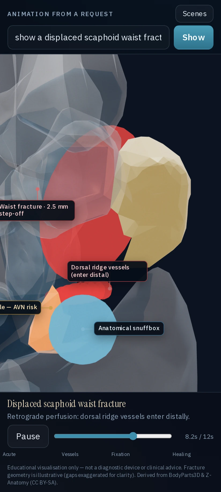
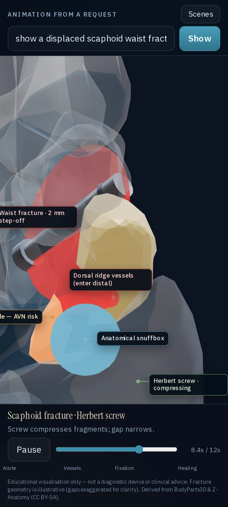
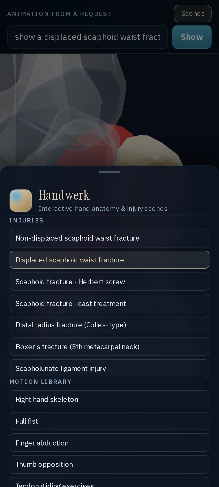
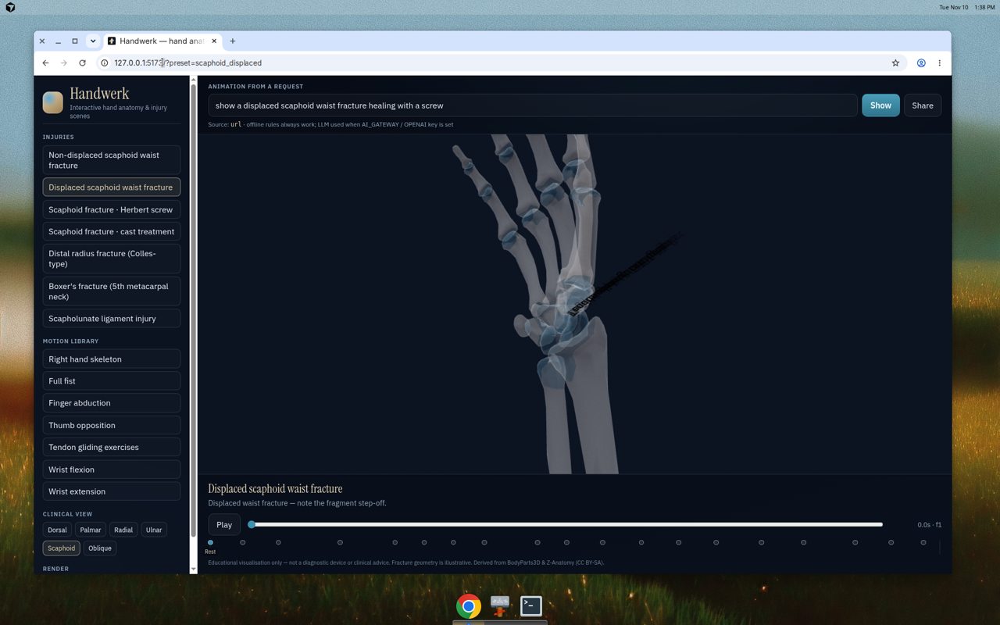
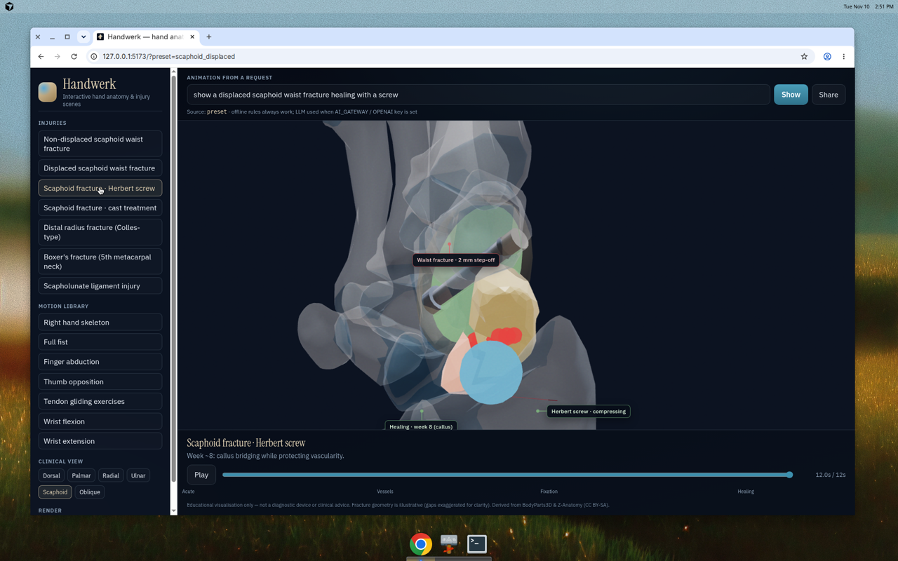
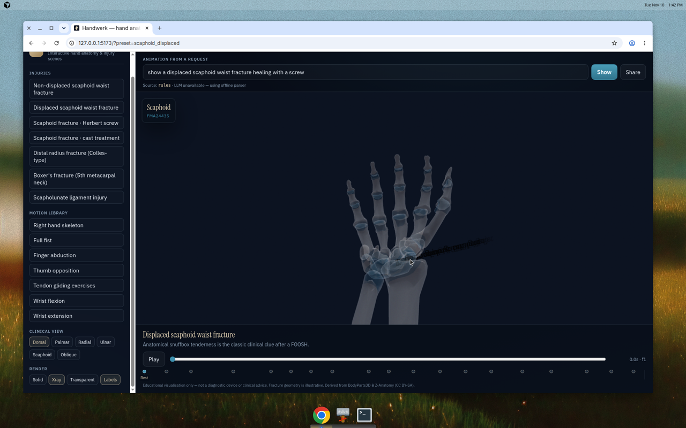
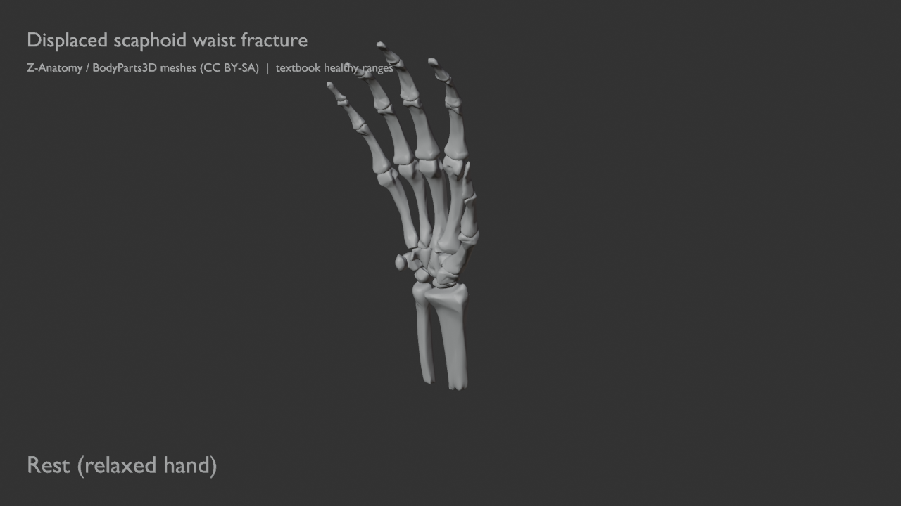

# Handwerk

Interactive, request-driven **hand anatomy & injury animations** in the browser — built from a rigged Blender right-hand skeleton. Motivating case: visualising a **scaphoid waist fracture** (including displacement, snuffbox, retrograde blood supply, cast vs Herbert screw, healing over weeks).

Blender authors and renders. The browser plays the same content back via glTF.

```
┌────────────────────┐     scene-spec JSON      ┌──────────────────────┐
│  Natural language  │ ───────────────────────► │  Validator + limits  │
│  or preset button  │     (DSL v1)             └──────────┬───────────┘
└────────────────────┘                                     │
         │                                                 ▼
         │ offline rules │ optional LLM              ┌─────────────┐
         └───────────────┴──────────────────────────►│ SceneSpec   │
                                                     └──────┬──────┘
                            ┌───────────────────────────────┼────────────────┐
                            ▼                               ▼                ▼
                   ┌─────────────────┐           ┌──────────────────┐  ┌─────────────┐
                   │ Browser (R3F)   │           │ Blender headless │  │ Share URL   │
                   │ hand_skeleton   │           │ EEVEE / Cycles   │  │ ?preset= /  │
                   │ .glb + overlays │           │ MP4 / PNG        │  │ ?scene=lz   │
                   └─────────────────┘           └──────────────────┘  └─────────────┘
```

## Quick start

```bash
cd web
npm ci
npm run dev
```

Open http://localhost:5173 — try *“show a displaced scaphoid waist fracture healing with a screw”* or *“make a fist then flex the wrist 60°”*.

```bash
npm test        # scene-spec parser / validator
npm run build   # production bundle → web/dist
```

### Optional LLM parsing

The offline keyword/rule parser always works. If `AI_GATEWAY_API_KEY` or `OPENAI_API_KEY` is set on Vercel, `POST /api/parse` uses the Vercel AI SDK / AI Gateway and falls back to rules on failure.

## What’s in the box

| Area | Details |
|------|---------|
| **Viewer** | Orbit/zoom, bone hover labels (FMA ids), highlight + dim, solid / X-ray / transparent, clinical cameras (dorsal, palmar, radial, ulnar, scaphoid, oblique) |
| **Timeline** | 45s baked motion @ 30 fps with 19 markers (fist, opposition, tendon gliding, wrist flex/ext, deviation…) |
| **Injuries** | Scaphoid waist fracture (displaced / non-displaced, fracture plane, snuffbox, retrograde supply, cast, Herbert screw, healing week); distal radius (Colles); boxer’s (5th MC neck); scapholunate gap |
| **Scene DSL** | Versioned JSON: bones, poses within joint limits, injuries, camera, captions, timing — see `shared/scene/schema.ts` |
| **Blender** | `blender/scripts/render_scene.py` renders a scene-spec; `split_scaphoid.py` bisects the scaphoid reproducibly |
| **CI** | Lint, tests, build; Blender workflow renders example PNGs as artifacts |

## Assets

Source pack lives in `blender-hand/`:

- `hand_skeleton.blend` — Blender 4.2, rigged + animated
- `hand_skeleton.glb` — web export (armature + clip, frames 1–1351)
- `scene_info.json`, `joints.json`, `poses.json`, `map.tsv`
- `source/*.py` — original build scripts
- `stills/` — labeled dorsal / palmar / radial references

Web copies used at runtime: `web/public/assets/`.

**29 bone meshes** (radius, ulna, 8 carpals, 5 metacarpals, 14 phalanges), materials `Bone` / `Cartilage`, units = metres. Carpals: proximal row → `Wrist_Radiocarpal`; distal row → `Wrist_Midcarpal`. Joint limits are **not** in the GLB — enforced from `scene_info.json` via the validator.

## Scene-spec (DSL)

```json
{
  "version": 1,
  "title": "Displaced scaphoid waist fracture",
  "camera": { "view": "scaphoid" },
  "highlights": ["Scaphoid"],
  "pose": "rest",
  "injuries": [{
    "type": "scaphoid_fracture",
    "location": "waist",
    "displaced": true,
    "displacementMm": 2.5,
    "fixation": "herbert_screw",
    "healingWeek": 8
  }],
  "disclaimer": true
}
```

Share links: `?preset=scaphoid_screw` or `?scene=<lz-string compressed JSON>`.

Examples: `scenes/*.json`.

## Blender pipeline

```bash
# Validate without Blender
python3 blender/scripts/render_scene.py --scene scenes/scaphoid_displaced.json --dry-run

# Render a still (Blender 4.2+)
blender --background blender-hand/hand_skeleton.blend \
  --python blender/scripts/render_scene.py -- \
  --scene scenes/scaphoid_displaced.json \
  --out artifacts/scaphoid_displaced.png --still

# Reproducible scaphoid split
blender --background blender-hand/hand_skeleton.blend \
  --python blender/scripts/split_scaphoid.py -- \
  --output blender-hand/hand_skeleton_fracture.blend --gap-mm 2.5
```

GitHub Actions: `.github/workflows/blender-render.yml` installs Blender 4.2 and uploads PNG artifacts.

## Android app

Handwerk also ships as a **native Android** app via [Capacitor](https://capacitorjs.com/) (`io.github.prgrmmrjns.handwerk`). The Vite/React/three.js viewer in `web/` is packaged with local GLB assets so injury scenes work **offline**. Touch: one-finger orbit, pinch zoom, two-finger pan. On phones the scene sidebar becomes a bottom sheet.

### Install from GitHub Releases

1. Open the latest **[android-latest](https://github.com/Prgrmmrjns/handwerk/releases/tag/android-latest)** release (published from `main` by CI).
2. Download `Handwerk-debug.apk`.
3. On your phone, allow install from that source, then open the APK.

Deep links: `handwerk://preset/scaphoid_displaced` or `https://handwerk-ruddy.vercel.app/?preset=scaphoid_screw`.

On-device **offline rule parser** always runs. If the network is up, the app may also call hosted `POST https://handwerk-ruddy.vercel.app/api/parse` and fall back gracefully when unreachable.

### Build the APK yourself

Requirements: Node 20+, JDK 21, Android SDK (platform 35 + build-tools 35).

```bash
cd web
npm ci
npm run android:apk
# → web/android/app/build/outputs/apk/debug/app-debug.apk
```

Or step by step:

```bash
npm --prefix web run build
npx --prefix web cap sync android
cd web/android && ./gradlew assembleDebug
```

Open in Android Studio: `npm --prefix web run cap:open`.

CI: `.github/workflows/android.yml` builds the debug APK on push/PR (artifact `handwerk-android-debug`) and publishes `android-latest` on `main`. The web Vercel deploy is unchanged.

Phone UI (Pixel-sized viewport of the Capacitor WebView layout — same CSS/touch shell as the APK):







## Deploy (Vercel)

Project `handwerk` is linked to this repo (production branch `main`). Preview deployments build from PR branches via `vercel.json` (`web/dist` output + `/api/parse`).

Manual env (optional): `AI_GATEWAY_API_KEY` or `OPENAI_API_KEY`.

## Medical disclaimer

Educational visualisation only — **not** a diagnostic device or clinical advice. Fracture geometry is illustrative.

## Credits & license

- Mesh lineage: **BodyParts3D** (DBCLS) and **Z-Anatomy** — **CC BY-SA** (see `LICENSE`)
- App / rig / tooling: MIT (see `LICENSE`)
- Built for Jonas (Uniklinik Aachen) as a portfolio piece at the medical × ML boundary

## Screenshots

Browser — displaced scaphoid scene:



Herbert screw preset:



X-ray mode + bone hover:



Blender headless still from the same scene-spec (`artifacts/` / CI artifacts):


